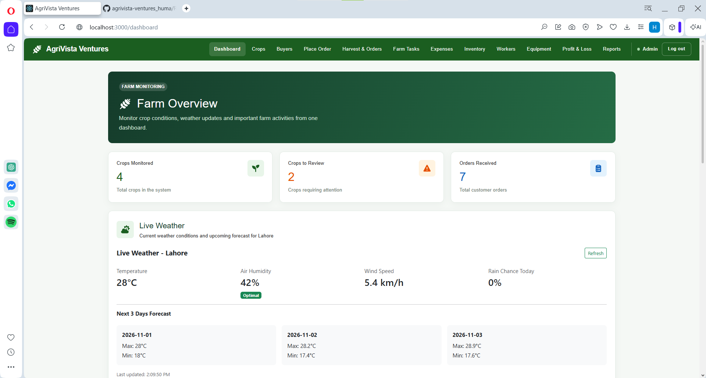
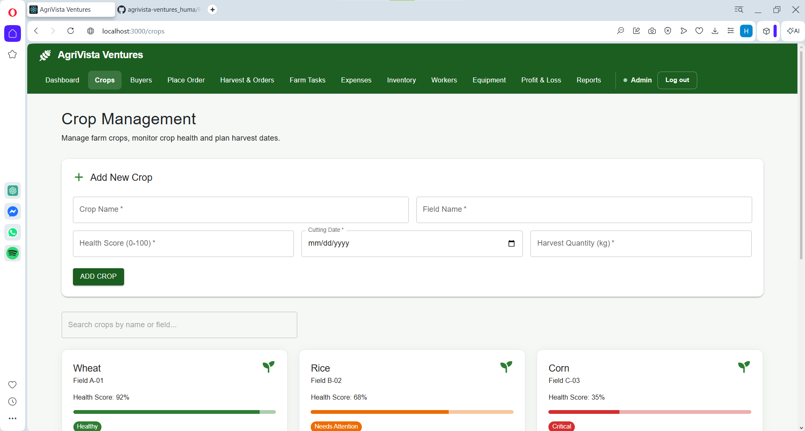
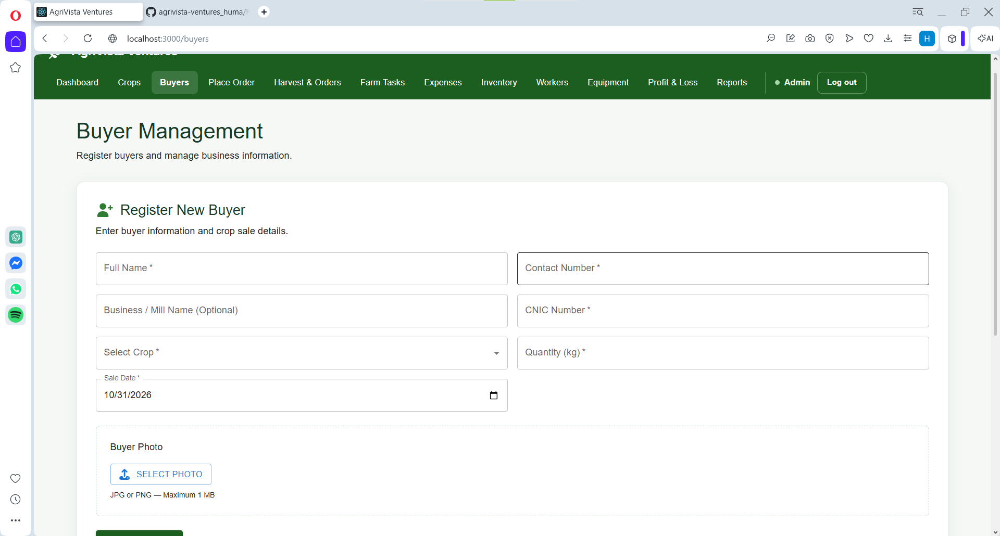
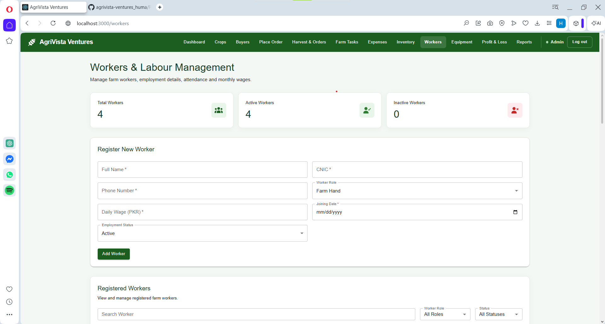
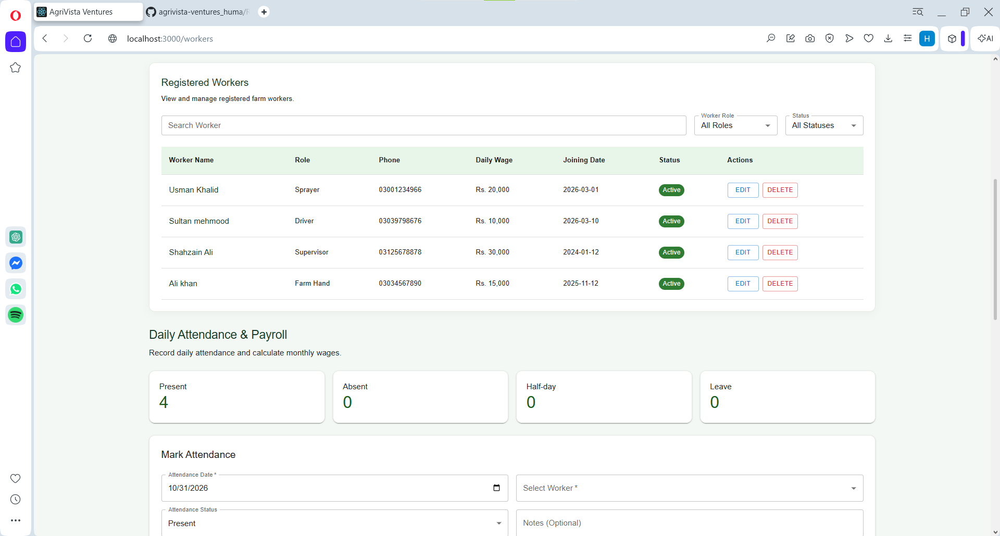
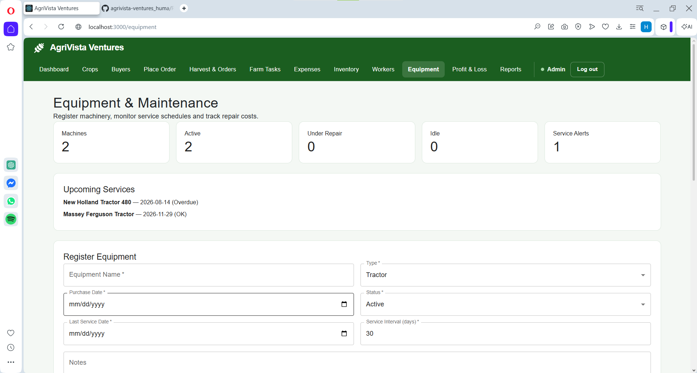
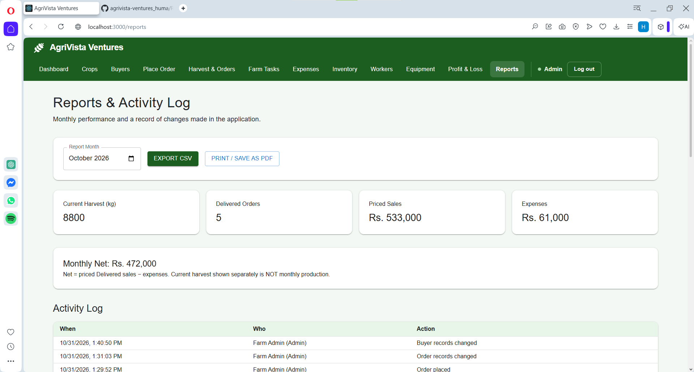

# 🌿 AgriVista Ventures

### Smart Agriculture Management System

AgriVista Ventures is a React-based Agriculture Management System developed to simplify and organize daily farming operations through a centralized, responsive dashboard.

The application helps farm managers monitor crops, weather conditions, harvest schedules, buyers, customer orders, farming tasks, expenses, inventory, workers, attendance, equipment, and maintenance.

It provides financial insights, operational reports, and activity tracking to support better farm management decisions.

---

## 📌 Project Overview

**Project Name:** AgriVista Ventures
**Developer:** Huma Zafar
**Internship:** Full Stack Developer
**Batch:** 6
**Organization:** U Devs (SMC-Private) Limited
**Project Type:** Frontend Agriculture Management System

**GitHub Repository:**
https://github.com/HumaZafar433/agrivista-ventures_huma

**Live Demo:**
https://agrivista-venturess-huma.netlify.app/

---

## 🚀 Key Features

### 1. Dashboard & Farm Overview

The dashboard provides a centralized overview of important farm activities.

**Features:**

* Summary of monitored crops and farming operations.
* Crop health overview with visual indicators.
* Upcoming harvest priorities.
* Current weather information.
* Workforce and equipment statistics.
* Weekly attendance visualization.
* Equipment maintenance reminders.
* Important operational alerts.

### 2. Live Weather Monitoring

AgriVista integrates the Open-Meteo weather API to display current weather conditions.

**Features:**

* Current temperature.
* Relative humidity.
* Wind speed.
* Rainfall probability.
* Short-term weather forecast.
* Weather loading and error handling.
* Manual weather refresh.
* Redux-based weather state management.

Weather requests are handled using Axios and Redux asynchronous actions.

### 3. Crop Management

The Crop Management module helps maintain farming records.

**Features:**

* Add new crops.
* View existing crop records.
* Edit crop information.
* Delete crop records.
* Record field names and planting details.
* Track crop health scores.
* Manage harvest quantities.
* Record planned cutting dates.
* Search and filter crop information.

Crop health is displayed using three categories:

* **Healthy**
* **Needs Attention**
* **Critical**

### 4. Crop Cutting & Harvest Schedule

The application tracks upcoming harvesting activities.

**Features:**

* Planned cutting dates.
* Field information.
* Days remaining until harvest.
* Due-soon indicators.
* Overdue harvest indicators.
* Harvest priorities on the dashboard.

### 5. Buyer Management

The Buyer Management module maintains records of crop buyers.

**Features:**

* Register new buyers.
* Store buyer names and contact information.
* Record CNIC details.
* Upload buyer photographs.
* Preview selected photographs.
* Select crops and enter quantities.
* Record transaction dates.
* Validate form information.
* Prevent duplicate CNIC registration.
* Check available crop quantities.
* Display registered buyers.
* Maintain buyer information using localStorage.

**Validation Rules:**

* Buyer name must contain at least three letters.
* CNIC must contain 13 digits.
* CNIC follows the format `12345-1234567-1`.
* Duplicate CNIC registration is restricted.
* Buyer photographs must be JPG or PNG.
* Maximum photograph size is 1 MB.
* Crop quantity must not exceed available stock.
* Required fields must be completed before submission.

### 6. Order Management

The Order Management module tracks crop sales and customer orders.

**Features:**

* Create new orders.
* Select buyers and crops.
* Enter order quantities.
* Check available crop stock.
* Record order dates.
* Track Pending and Delivered orders.
* Record selling prices per kilogram.
* Automatically calculate order totals.
* Update order delivery status.
* View order details.
* Include delivered sales in financial calculations.

**Order Calculation:**

```text
Order Total = Quantity × Selling Price per kg
```

Only delivered orders with valid recorded selling amounts are included in confirmed revenue calculations.

### 7. Farm Task Scheduler

This module helps organize routine farming activities.

**Features:**

* Create new farming tasks.
* Edit existing tasks.
* Mark tasks as completed.
* Delete tasks.
* Assign tasks to crops.
* Record task due dates.
* Track irrigation, fertilizer, spraying, and labour activities.
* Monitor Pending, Completed, and Overdue tasks.
* Search and filter task records.

### 8. Expense Management

The Expense Management module records farming expenditures.

**Features:**

* Add farming expenses.
* Edit expense records.
* Delete expenses.
* Categorize expenditures.
* Associate expenses with crops where applicable.
* Track labour expenses.
* Track fuel and equipment repair costs.
* Calculate total recorded expenses.
* Display expense summaries.

**Expense Categories Include:**

* Seeds
* Fertilizer
* Labour
* Fuel
* Spraying
* Repairs
* Other farming expenses

### 9. Inventory Management

The Inventory module helps manage agricultural supplies.

**Features:**

* Add inventory items.
* Update inventory information.
* Delete inventory records.
* Track available quantities.
* Maintain minimum stock levels.
* Record inventory usage.
* Identify low-stock items.
* Display inventory alerts.

The inventory system supports agricultural inputs such as fertilizer, pesticides, and seeds.

### 10. Profit & Loss Management

The Profit & Loss module provides financial summaries of farming operations.

**Features:**

* Calculate revenue from delivered orders.
* Track recorded farming expenses.
* Calculate net profit or loss.
* Display crop-wise financial information.
* Compare sales and expenses.
* Highlight orders with missing selling prices.

**Financial Formulas:**

```text
Revenue = Sum of valid delivered order totals

Net Profit / Loss = Revenue - Total Expenses
```

**Important:** Delivered orders without valid selling prices are excluded from confirmed revenue. The application displays a warning when these records make financial results incomplete.

### 11. Workers & Labour Management

The Workers Management module helps maintain farm employee information.

**Features:**

* Register new workers.
* View registered workers.
* Edit worker details.
* Delete worker records.
* Search workers.
* Filter workers by role and status.
* Maintain worker employment information.
* Validate CNIC and contact numbers.
* Track daily wages.
* Display worker statistics.

**Worker Information Includes:**

* Full Name
* CNIC
* Phone Number
* Worker Role
* Daily Wage
* Joining Date
* Employment Status

**Supported Worker Roles:**

* Farm Hand
* Driver
* Supervisor
* Sprayer

### 12. Daily Attendance Management

The Attendance module records daily worker attendance.

**Features:**

* Select attendance dates.
* Mark worker attendance.
* Update attendance records.
* Delete attendance records.
* Prevent duplicate attendance records for the same worker and date.
* Display attendance summaries.
* Track workforce presence.

**Attendance Statuses:**

* Present
* Absent
* Half-day
* Leave

The dashboard includes a weekly attendance visualization showing Present and Absent worker counts.

### 13. Salary & Payroll Management

The application automatically calculates worker wages using attendance records.

**Features:**

* Calculate wages according to daily attendance.
* Track present days and half-days.
* Generate monthly wage summaries.
* Display payable wages.
* Record wage payments.
* Connect wage payments with the Expenses module.

**Wage Calculation:**

```text
Monthly Wage =
(Present Days + 0.5 × Half Days) × Daily Wage
```

When wages are paid, the corresponding Labour expense is included in financial records.

### 14. Equipment Management

The Equipment module tracks farming machinery.

**Features:**

* Register farm equipment.
* View registered machinery.
* Update equipment information.
* Delete equipment records.
* Search and filter equipment.
* Track operational status.
* Record purchase dates.
* Maintain service intervals.
* Display equipment statistics.

**Equipment Types Include:**

* Tractor
* Water Pump
* Sprayer
* Harvester
* Other Machinery

**Equipment Statuses:**

* Active
* Under Repair
* Idle

### 15. Equipment Maintenance Tracker

The Maintenance module helps organize equipment servicing.

**Features:**

* Add maintenance records.
* Edit service information.
* Delete maintenance records.
* Record service dates.
* Track maintenance descriptions.
* Record service costs.
* Identify service providers.
* Calculate upcoming service dates.
* Highlight overdue maintenance.
* Connect maintenance expenses with the financial system.

**Next Service Calculation:**

```text
Next Service Date =
Last Service Date + Service Interval
```

Maintenance costs are reflected in the Expenses and Profit & Loss modules.

### 16. Reports & Activity Log

AgriVista provides reporting features for monitoring agricultural operations.

**Features:**

* Monthly farming reports.
* Harvest summaries.
* Delivered order statistics.
* Recorded sales revenue.
* Expense summaries.
* Monthly net calculations.
* Export reports to CSV.
* Print reports.
* Save reports as PDF through the browser.
* View application activity history.

**Activity Log Records:**

* Date and time.
* User performing the action.
* User role.
* Action description.

Examples include:

* Crop added.
* Order delivered.
* Worker registered.
* Attendance marked.
* Equipment updated.
* Maintenance recorded.
* Expense added.

Sensitive information such as passwords, CNIC numbers, and buyer photographs is not included in activity descriptions.

### 17. Authentication & Role-Based Access

The application includes demonstration authentication with two user roles.

**Admin:**

* View records.
* Add records.
* Edit records.
* Delete permitted records.
* Manage operational activities.
* Update order delivery status.

**Manager:**

* View records.
* Add permitted records.
* Perform allowed daily operations.
* Restricted from administrative editing and deletion.

Protected routes help restrict access to authenticated users.

---

## 🛠️ Technologies Used

| Technology       | Purpose                                |
| ---------------- | -------------------------------------- |
| React.js         | Frontend user interface                |
| JavaScript ES6+  | Application logic                      |
| Redux Toolkit    | Global state management                |
| React-Redux      | Connecting React components with Redux |
| Redux Thunk      | Asynchronous application actions       |
| React Router DOM | Application routing                    |
| Axios            | Weather API requests                   |
| Material UI      | Interface components                   |
| Bootstrap        | Responsive styling                     |
| Recharts         | Data visualization                     |
| Font Awesome     | Icons                                  |
| HTML5            | Page structure                         |
| CSS3             | Styling                                |
| localStorage     | Browser-based data persistence         |
| Open-Meteo API   | Live weather information               |
| Git & GitHub     | Version control                        |

---

## 🗂️ Project Structure

The application includes React components, Redux modules, reusable utilities, and compatibility files for existing imports.

```text
agriculture-system/
│
├── public/
│
├── src/
│   │
│   ├── app/
│   │   └── redux/
│   │       ├── actions/
│   │       ├── api/
│   │       ├── reducers/
│   │       ├── selectors/
│   │       ├── middleware/
│   │       └── store/
│   │
│   ├── components/
│   │   ├── auth/
│   │   ├── Dashboard.js
│   │   ├── DashboardExtras.js
│   │   ├── WeatherCard.js
│   │   ├── Crops.js
│   │   ├── CropHealthList.js
│   │   ├── CuttingSchedule.js
│   │   ├── Buyers.js
│   │   ├── BuyerForm.js
│   │   ├── OrderForm.js
│   │   ├── SupplierOrders.js
│   │   ├── HarvestSummary.js
│   │   ├── Tasks.js
│   │   ├── Expenses.js
│   │   ├── Inventory.js
│   │   ├── ProfitLoss.js
│   │   ├── Reports.js
│   │   ├── Workers.js
│   │   ├── WorkerForm.js
│   │   ├── WorkerTable.js
│   │   ├── AttendanceRegister.js
│   │   ├── Equipment.js
│   │   ├── EquipmentForm.js
│   │   ├── EquipmentTable.js
│   │   ├── MaintenanceForm.js
│   │   ├── MaintenanceLog.js
│   │   └── ConfirmModal.js
│   │
│   ├── store/
│   │   ├── reducers/
│   │   ├── middleware/
│   │   └── selectors/
│   │
│   ├── hooks/
│   ├── data/
│   ├── App.js
│   ├── App.css
│   └── index.js
│
├── package.json
├── package-lock.json
└── README.md
```

The `src/store` directory contains existing Redux modules and compatibility imports. The application uses a central Redux Store rather than separate stores for each module.

---

## 🔄 Redux Architecture

AgriVista uses Redux Toolkit to manage application data centrally.

Redux provides predictable state updates and helps different components access shared information.

### Redux State Tree

```text
Redux Store
│
├── auth
├── ui
├── crops
├── buyers
├── orders
├── weather
├── tasks
├── expenses
├── inventory
├── workers
├── attendance
├── equipment
├── maintenance
└── activity
```

### Redux Data Flow

For synchronous operations:

```text
User Interaction
       ↓
Redux Action
       ↓
Reducer
       ↓
Central Redux Store
       ↓
React Component Updates
```

For asynchronous operations:

```text
User Interaction
       ↓
Redux Async Action / Thunk
       ↓
API or Browser Storage Layer
       ↓
Success / Failure Action
       ↓
Reducer Updates State
       ↓
Central Redux Store
       ↓
Updated React UI
```

### Redux Responsibilities

**Actions**

Describe operations such as adding, updating, deleting, or fetching records.

**API Layer**

Handles asynchronous data operations and external API requests.

**Reducers**

Update Redux state in response to dispatched actions.

**Selectors**

Read and calculate information from Redux state.

**Middleware**

Supports additional functionality such as activity logging and browser storage persistence.

**Store**

Combines application state and makes it available to React components.

The application uses a combination of Redux Toolkit slices and asynchronous module actions. The Redux module structure is being organized around the Actions, API, Reducers, and Store pattern.

---

## 💾 Data Storage

AgriVista is a frontend demonstration application.

It uses browser localStorage instead of a backend database.

Application data includes:

* Crop records.
* Buyer records.
* Customer orders.
* Farming tasks.
* Expenses.
* Inventory.
* Worker information.
* Attendance records.
* Equipment details.
* Maintenance history.
* Activity logs.
* User session information.

### Important Notes

* Records can remain available after refreshing the page.
* Data is stored in the browser being used.
* Data is not automatically shared across devices.
* Clearing browser storage may delete saved records.
* Different localhost ports may use different browser storage.
* GitHub does not contain the user's browser localStorage records.

This application is intended for learning and demonstration purposes.

---

## 💻 Installation & Setup

### Prerequisites

Before running the project, install:

* Node.js
* npm
* Git
* A code editor such as Visual Studio Code

### Step 1 — Clone the Repository

```bash
git clone https://github.com/HumaZafar433/agrivista-ventures_huma.git
```

### Step 2 — Open the Project

```bash
cd agrivista-ventures_huma
```

### Step 3 — Install Dependencies

```bash
npm install
```

### Step 4 — Start the Development Server

```bash
npm start
```

The application normally runs at:

```text
http://localhost:3000
```

### Step 5 — Create a Production Build

```bash
npm run build
```

This generates an optimized production build inside the `build` folder.

**Windows PowerShell Note:** If PowerShell blocks npm scripts, the commands can be run using `npm.cmd`, for example:

```powershell
npm.cmd start
```

---

## 🔐 Demo Login Credentials

The following accounts are provided for demonstration purposes.

| Role    | Username | Password   |
| ------- | -------- | ---------- |
| Admin   | admin    | admin123   |
| Manager | manager  | manager123 |

These credentials are intended only for testing the frontend authentication workflow.

**Security Note:** Client-side authentication and role restrictions are not sufficient for production applications. A production system would require secure backend authentication, authorization, and database protection.

---

## 📊 Dashboard & Analytics

The dashboard combines several operational indicators.

**Crop Analytics**

* Total crops monitored.
* Crop health distribution.
* Crops requiring attention.
* Upcoming harvest dates.

**Workforce Analytics**

* Total registered workers.
* Present workers.
* Absent workers.
* Monthly wages payable.
* Weekly attendance trends.

**Equipment Analytics**

* Equipment status counts.
* Upcoming maintenance dates.
* Equipment requiring servicing.
* Maintenance alerts.

**Financial Analytics**

* Delivered sales.
* Recorded expenses.
* Net profit or loss.
* Crop-wise financial summaries.

---

## 📱 Responsive Design

The interface is designed to support different screen sizes.

* Desktop computers.
* Laptops.
* Tablets.
* Mobile devices.

The application uses responsive layouts, cards, tables, forms, and navigation elements.

---

## 📸 Project Screenshots

### 1. Dashboard & Live Weather


### 2. Crop Management


### 3. Buyer Management


### 4. Workers Management


### 5. Attendance & Payroll


### 6. Equipment & Maintenance


### 7. Profit & Loss


### 8. Reports & Activity Log


## 🧪 Application Testing

The application can be tested through the following workflows:

**Crop Management:** Add, edit, view, and delete crop records.

**Buyer Registration:** Validate buyer details, upload a photograph, select a crop, and check stock availability.

**Order Management:** Create an order, record the selling price, mark it Delivered, and verify the revenue calculation.

**Worker Management:** Register a worker, edit details, record attendance, and calculate wages.

**Payroll:** Pay wages and confirm the corresponding Labour expense.

**Equipment Management:** Add equipment, update its information, and record maintenance.

**Maintenance:** Update service costs and confirm that the linked expense is updated correctly.

**Activity Log:** Perform an operation and verify that an activity entry appears.

**Data Persistence:** Refresh the page and verify that saved information remains available.

**Role Restrictions:** Check access and available actions for Admin and Manager accounts.

---

## 🎯 Project Objectives

The main objectives of AgriVista Ventures are to:

* Simplify farm management operations.
* Organize agricultural records.
* Improve visibility into crop and harvest activities.
* Monitor labour and machinery.
* Track agricultural expenses and sales.
* Provide useful dashboard insights.
* Demonstrate practical React and Redux development.
* Build a responsive and maintainable frontend application.

---

## ⚠️ Project Limitations

AgriVista Ventures is developed as an internship demonstration project.

* No production backend or database is used.
* Data is stored locally in the browser.
* User records are not synchronized across different devices.
* Authentication is intended for demonstration only.
* Financial calculations depend on correctly recorded sales and expenses.
* Live weather requires an internet connection.

---

## 👩‍💻 Developer

**Huma Zafar**

Full Stack Developer — Batch 6

U Devs (SMC-Private) Limited

**GitHub:**
https://github.com/HumaZafar433/agrivista-ventures_huma

---

## 📄 Conclusion

AgriVista Ventures demonstrates how React, Redux Toolkit, reusable components, API integration, and browser-based data persistence can be combined to build an Agriculture Management System.

The project brings farming operations into a centralized dashboard and provides tools for crop management, buyer registration, customer orders, worker attendance, equipment maintenance, expense tracking, and reporting.

